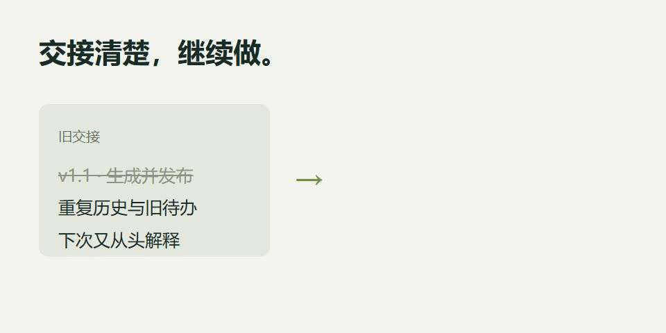

[](https://raw.githubusercontent.com/jidekaixin2dian/handoff/main/assets/handoff-intro.mp4)

[中文](README.md) · [Quick start](#start-with-codex) · [Example](docs/example.md) · [Demo](#demo)

# handoff

**A new conversation. The same project, moving forward.**

Starting a new conversation during a long AI-assisted task often means explaining the project again: which version is current, what is finished, and what comes next?

`handoff` is a lightweight project handoff skill. It verifies the workspace state, prepares a concise current entry point, and links to the evidence needed for the next task. Help the next person or agent pick up where the project stands. Instruction-only, MIT licensed, with no extra service to deploy.

[Watch / download the 36-second introduction](https://raw.githubusercontent.com/jidekaixin2dian/handoff/main/assets/handoff-intro.mp4)

## Start with Codex

Install into the current project using the [skills CLI](https://github.com/vercel-labs/skills):

```bash
npx skills add jidekaixin2dian/handoff --skill handoff --agent codex
```

Then invoke it in a Codex environment that supports `$skill-name`:

```text
$handoff I want to continue this project in a new conversation.
Verify its current state, refresh the handoff entry point,
and preserve the evidence, constraints, and next action.
```

You can also ask `$skill-installer` to install from `https://github.com/jidekaixin2dian/handoff/tree/main/skills/handoff`, or copy the `skills/handoff` directory into a project or user `.agents/skills/` location. Inspect existing skills before overwriting them. See [OpenAI's skill documentation](https://learn.chatgpt.com/docs/build-skills) for discovery and invocation details.

## A useful handoff answers four questions

| Current state | Next action | Constraints | Evidence |
| --- | --- | --- | --- |
| Which version and findings are current? | What is unfinished or needs a human decision? | What must the successor preserve? | Where is the canonical material for this task? |

Keep historical instructions separate from current tasks. An offline check does not establish human acceptance, and an old release plan does not authorize a new publication.

## See the workflow



[See the before-and-after example](docs/example.md).

## Keep the boundaries

Preserve raw data, frozen evaluations, human ratings, hashes, unique decisions, and existing user changes, including untracked files. Only consider repository cleanup when requested; a file being downloadable again does not establish that it can be removed safely.

## Demo

- [Introduction video](https://raw.githubusercontent.com/jidekaixin2dian/handoff/main/assets/handoff-intro.mp4): a 36-second demonstration of the project handoff workflow.
- [Video source ZIP](downloads/handoff-video-source.zip): the editable Remotion project, local fonts, and audio assets.
- [Video cover](assets/video-preview.jpg) · [Social card](assets/social-card.png) · [Workflow GIF](assets/workflow.gif).

## Feedback

For feedback, [open an issue](https://github.com/jidekaixin2dian/handoff/issues/new) with the request, observed behavior, and expected behavior. Remove credentials and private material before sharing.

[Skill source](skills/handoff/SKILL.md) · [MIT License](LICENSE) · jidekaixin2dian
