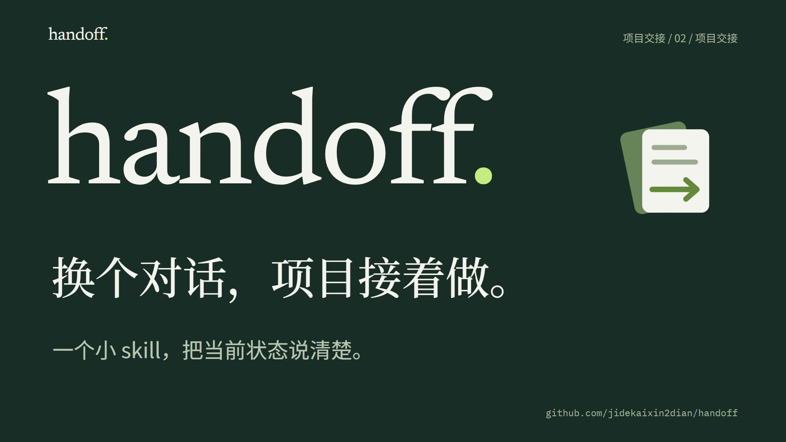
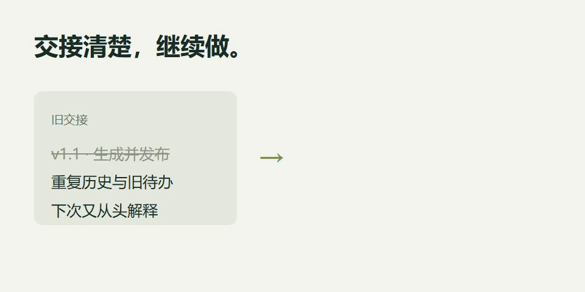

[](https://raw.githubusercontent.com/jidekaixin2dian/handoff/main/assets/handoff-intro.mp4)

[English](README.en.md) · [快速开始](#快速开始) · [触发方式](#触发方式按意图自启) · [交接示例](docs/example.md) · [项目演示](#项目演示)

# handoff · 项目交接

**换个对话，项目接着做。**

用 AI 做长任务，换个新对话时，往往要重新解释项目：哪个版本有效？哪些事已经做完？接下来做什么？

`handoff` 是一个轻量的项目交接 skill。它先核实工作区的当前状态，再清掉交接里的过时内容、按任务建好索引，让下一位 Agent 或同事知道从哪里接着做。**你不需要记命令**：只要出现换会话、换项目、换 Agent、收尾这类的意图，它就该自己接上。纯指令，MIT 开源，不需要额外部署服务。

[观看 / 下载 36 秒介绍视频](https://raw.githubusercontent.com/jidekaixin2dian/handoff/main/assets/handoff-intro.mp4)

## 快速开始

使用 [skills CLI](https://github.com/vercel-labs/skills) 安装到当前项目的 Codex（Claude Code 及其它支持 skills 的 Agent 同理）：

```bash
npx skills add jidekaixin2dian/handoff --skill handoff --agent codex
```

装好之后，正常说话就行：

```text
我要换个新对话继续这个项目。
```

也可以显式点名：

```text
$handoff 我要换个新对话继续这个项目。
请核实当前状态，更新交接入口，保留关键证据和下一步。
```

<details>
<summary>用 skill-installer 或手动安装</summary>

```text
$skill-installer 从 https://github.com/jidekaixin2dian/handoff/tree/main/skills/handoff 安装 handoff。
```

也可以复制 [`skills/handoff`](skills/handoff/SKILL.md) 目录到项目的 `.agents/skills/handoff/`，或用户目录的 `.agents/skills/handoff/`。已有同名技能时，先核对现有内容，避免覆盖。具体目录与调用方式见 [OpenAI 文档](https://learn.chatgpt.com/docs/build-skills)。

</details>

## 触发方式：按意图自启

`handoff` 不依赖手动调用。下列任何一种意图出现时，它都应该直接执行，而不是等用户敲 `$handoff`：

| 意图 | 用户可能怎么说 |
| --- | --- |
| 换新会话 / 重开对话 | 「开个新窗口继续」「上下文太长了，换个对话」「这个会话要关了」 |
| 换项目 | 「先放下这个，做另一个项目」「切到 X 项目」 |
| 换轻对话 | 「接下来随便聊两句」「只问一件事，不动代码」 |
| 换 Agent / 换人接手 | 「让另一个 agent 接着做」「交给同事」「换个模型重来」 |
| 收尾 / 离开 | 「今天就到这」「先暂停」「下次接着做」 |
| 显式点名 | `handoff`、`$handoff`、交接、交接文档 |

只做审查、不改文件，也可以直接说：

```text
$handoff 只读审查当前交接，指出过期状态、断链和遗漏，不修改文件。
```

## 接手时，四件事说清楚

| 当前状态 | 下一步 | 关键约束 | 证据入口 |
| --- | --- | --- | --- |
| 哪个版本有效，哪些结果已验证 | 什么尚未完成，什么需要人决定 | 哪些数据、接口和历史材料要保留 | 按任务链接到权威文件，细节按需展开 |

它不会把“离线检查通过”写成“人工已经接受”，也不会把旧交接里的发布计划当作新的授权。

## 交接不是越写越长

每次交接默认会做两件事，不需要额外提醒：

- **清过时**：已完成的“下一步”、被推翻的版本号、失效链接、粘进来的日志，直接改写为当前事实；要留痕就降级成「历史」里的一行加链接。
- **建索引**：正文超过 150 行、待办超过 8 条、或同一事实散落在多个文件时，`handoff.md` 只留「状态 / 下一步 / 约束 / 索引 / 历史摘要」，细节按任务链接回原处。

拆分后的样子见 [交接前后](docs/example.md)。

## 看一眼流程



## 适合这些时候

- 要换一个新对话，继续长任务。
- 交接文档越写越长，需要去重、清理过时状态并保留原始证据。
- Agent 或同事接手，希望快速找到当前状态和下一步。
- 明确要求整理项目文件，希望先核实引用、可再生性和独有内容。

## 保留边界，才接得稳

原始数据、冻结评估、人工评分、哈希、独有决策和已有用户修改都要保留。**清理只作用于交接文档本身**：没有明确的仓库瘦身请求，不会顺手删除仓库里的其它文件；“还能重新下载”也不是充分的删除理由。

## 项目演示

- [介绍视频](https://raw.githubusercontent.com/jidekaixin2dian/handoff/main/assets/handoff-intro.mp4)：36 秒，展示项目交接流程。
- [视频源文件 ZIP](downloads/handoff-video-source.zip)：Remotion 项目、字体与配乐文件，可本地预览和修改。
- [视频封面](assets/video-preview.jpg) · [项目分享图](assets/social-card.png) · [流程 GIF](assets/workflow.gif)。

## 反馈

遇到不合适的交接行为，欢迎 [提交 Issue](https://github.com/jidekaixin2dian/handoff/issues/new)：说明请求、实际结果和预期结果，删去凭据、私有资料及个人路径后再分享。

[技能源码](skills/handoff/SKILL.md) · [MIT License](LICENSE) · jidekaixin2dian
